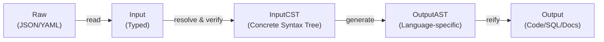

# schema-to

A modern transpiler for [JSON Schema 2020-12](https://json-schema.org/) and [OpenAPI 3.1+](https://www.openapis.org/), converting schema definitions into production-ready code and database migrations.

**Status:** Early development (v0.0.1). Core transpilation pipeline under active development.

Transpile JSON Schema 2020-12 into PostgreSQL DDLs, TypeScript types, and Python dataclasses/Pydantic models. Transpile OpenAPI 3.1+ into FastAPI endpoints with proper type hints.

## Table of Contents

- [Rationale](#rationale)
- [Goals](#goals)
- [Planned Targets](#planned-targets)
- [Non-Goals](#non-goals)
- [Quick Start](#quick-start)
- [Python API Design](#python-api-design)
- [Architecture](#architecture)
- [Contributing](#contributing)

## Rationale

[OpenAPI 3.1](https://www.openapis.org/blog/2021/02/16/migrating-from-openapi-3-0-to-3-1-0)
introduced a critical feature: full compatibility with [JSON Schema 2020-12](https://json-schema.org/specification), the current standard.
Unfortunately, four years later, most tooling is still stuck on OpenAPI 3.0 and JSON Schema 2019-09, which lack essential modern features.

**The problem:** Schema-first development requires tooling that understands current specifications. Most generators either:
- Ignore recent schema features
- Use ad-hoc workarounds instead of standard keywords
- Split effort between incompatible schema and API specs
- Miss opportunities for composition and validation

**The solution:** `schema-to` provides a unified transpilation pipeline that:
- Leverages the full JSON Schema 2020-12 specification
- Composes transpilation stages cleanly (input → CST → AST → output)
- Supports nested transpilation (e.g., Markdown in descriptions, JSON Schema in OpenAPI)
- Generates code in multiple languages from a single source of truth

## Goals

- **Formal abstractions:** Define transformation stages explicitly and decouple them.
  Use a concrete syntax tree (CST) for input with comprehensive support for all standard keywords.
- **Nested pipelines:** Support OpenAPI containing JSON Schema (as `schema`) and Markdown (as `description`), plus outputs that compose other formats (e.g., pg_jsonschema for JSON validation).
- **Multi-source:** Read from multiple files, e.g., auto-generating a table per `table-name.schema.json`.
- **Performance:** Fast transpilation for large schemas.
- **Simplicity:** No magic, minimal behavior-changing flags. Consistent, predictable behavior across targets.

## Planned Targets

### Input Formats
- JSON Schema 2020-12 (primary)
- OpenAPI 3.1, 3.2

### Output Formats
- **SQL:**
  - PostgreSQL DDL with JSON Schema validation via [pg_jsonschema](https://github.com/supabase/pg_jsonschema)
  - A whole directory of schema files to one migration, with foreign keys ordered
    across files, driven by `x-pg-table`, `x-pg-references`, `x-pg-index`, and friends
- **Backend:**
  - TypeScript types
  - Python dataclasses or Pydantic 2 models
  - FastAPI endpoints from OpenAPI
- **Documentation:**
  - SQL comments (from `title`, `description`, `examples`, etc.)
  - TypeScript/JSDoc comments
  - Python docstrings (Google-style)
  - CommonMark

## Non-Goals

- **Exhaustive feature coverage:** Keywords like `if`/`else`/`then`/`not` don't apply to all targets; we emit warnings when unsupported keywords are encountered.
- **Every language:** PRs for additional languages are welcome, but we maintain a curated focus.
- **Variants:** We avoid extensive target-specific variants of otherwise-supported languages.
- **Other input formats:** Only JSON Schema and OpenAPI 3.1+; no XML, Protocol Buffers, GraphQL schemas, etc.
- **Legacy support:** No pre-3.1 OpenAPI or pre-2020-12 JSON Schema.

## Quick Start

### Command-line

Install with `uv`:

```bash
uv tool install schema-to
```

Explore available options:

```bash
schema-to --help
```

Requires Python 3.14+.

## Python API Design

The Python API emphasizes composition and immutability:

**Core principles:**
- **Pipeline first:** Define the entire transpilation pipeline before processing files. The pipeline is immutable once created.
- **Inversion of control:** Pass sources and targets to the pipeline; let it orchestrate the stages.
- **Separated inputs:** `JsonSchemaSource` and `OpenAPISource` provide distinct type-safe APIs for their respective formats.
- **Immutable types:** Inputs, intermediate representations (CST, AST), and outputs are immutable. Changes produce new instances.
- **Composable stages:** Each pipeline stage (read → resolve → generate → reify) exposes a clean API for custom extensions.

**Example with multiple sources:**

```python
from schema_to import Pipeline, JsonSchemaSource, OpenAPISource, PostgresTarget, TypeScriptTarget

# Build a multi-target pipeline
pipeline = Pipeline(
    [
        JsonSchemaSource("schemas/"),  # Read all .schema.json files
        OpenAPISource("api.openapi.yaml"),  # Also include OpenAPI
        PostgresTarget(output="migrations/"),
        TypeScriptTarget(output="types/"),
    ]
)

# Process all sources in a single pass
pipeline.process()
```

## Architecture



**Pipeline stages:**

1. **Read:** Parse JSON/YAML into typed input representation (JSON Schema or OpenAPI object)
2. **Resolve & Verify:** Dereference `$ref` links, validate against schema spec
3. **CST (Concrete Syntax Tree):** Full tree with all keywords and metadata preserved
4. **Generate:** Transform CST into language-specific AST (TypeScript AST, Python AST, SQL AST, etc.)
5. **Reify:** Emit final output (TypeScript code, Python code, SQL DDL, documentation, etc.)

Each stage has a well-defined interface, allowing custom sources, targets, and transformations.

## Contributing

Contributions are welcome! See [CONTRIBUTING.md](CONTRIBUTING.md) for guidelines.

This project is licensed under the MIT License. See [LICENSE](LICENSE) for details.
